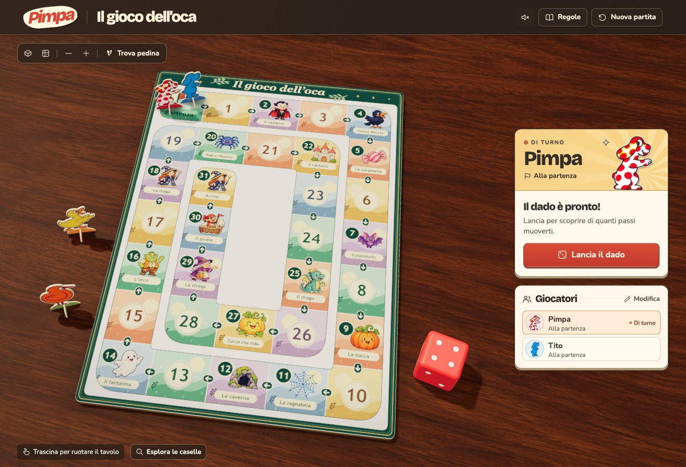

# vittorios_games

Giochi per Vittorio.

## Il gioco dell’oca di Pimpa

Un gioco da tavolo in 3D per 1–4 persone sullo stesso schermo. La plancia illustrata segue il percorso del gioco di famiglia. Ogni arrivo apre una breve scena con la pedina di chi gioca. Il codice del gioco, il motore 3D, i caratteri e le immagini sono tutti nella cartella [pimpa/dist](pimpa/dist). Puoi giocare sul Mac anche senza connessione o account ChatGPT.

### Avvio con un doppio clic

Nel Finder apri la cartella `pimpa`, poi `dist`, e fai doppio clic su **index.html**. Si aprirà nel browser. Tieni insieme i file di `dist` quando sposti il gioco.

### Avvio con un server locale

Per usare un indirizzo fisso, apri il Terminale nella cartella principale del repository ed esegui questo comando con Python 3:

```sh
python3 -m http.server 8766 --bind 127.0.0.1 --directory pimpa/dist
```

Apri [il gioco su questo computer](http://127.0.0.1:8766/). Il server accetta connessioni solo dal tuo Mac. Tieni aperto il Terminale mentre giocate e premi **Ctrl+C** per spegnere il server. Per giocare un altro giorno, rilancia lo stesso comando.

La partita si salva nel browser. Per riprenderla, usa lo stesso browser e lo stesso metodo di avvio. L’apertura dal Finder e l’indirizzo del server locale hanno salvataggi separati.

### Come si gioca

1. Premi **Modifica** per scegliere le pedine e i nomi dei giocatori.
2. Quando tocca a te, premi **Lancia il dado** o fai clic sul dado rosso.
3. Conta i puntini e premi **Muovi**, oppure tocca la tua pedina. Segui le frecce da un numero al successivo. La fascia bianca separa i giri della spirale. Alla fine dei passi si apre la casella. L’altoparlante attiva la voce italiana, disponibile anche offline. Con **Pausa** puoi fermare la scena e con **Rivedi** puoi guardarla di nuovo.
4. Segui quello che fa il tuo personaggio. Sulla 29 la strega gli porge una caramella, poi la pedina vola fino alla 5. Il gioco prosegue da solo. Puoi anche premere **Vola al 5** per partire subito. Vince chi raggiunge la maga.
5. **Trova pedina** avvicina la visuale a chi è di turno. In **Esplora le caselle** puoi sfogliare il percorso e premere **Guarda sul tavolo** per ritrovare una casella sulla plancia. Il pulsante **Ripristina la prospettiva** torna alla vista d’insieme.

[Guarda il percorso dall’alto](pimpa/dist/assets/illustrazioni-tabellone.webp)



## Sviluppo

**Parla** è in progettazione. Il piano prevede due comandi vocali, «lancia il dado» e «muovi», attivabili dal pulsante **Parla** per un massimo di quattro secondi. L’altoparlante del gioco riproduce già la narrazione italiana delle scene.

- [Piano Parla](docs/plans/PARLA.md) con obiettivi, attività, deliverable e criteri di accettazione.
- [Architettura](ARCHITECTURE.MD) con il funzionamento attuale del gioco e il punto d’integrazione di Parla.
- [Decisioni di progetto](DECISION.MD) con le motivazioni delle scelte su avvio, regole e riconoscimento vocale.
- [Guida ai test](docs/TESTING.md) con i comandi da eseguire e le verifiche da fare sul Mac.
